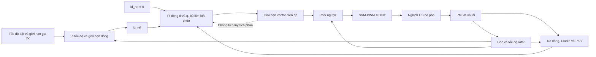

# Thuật toán FOC điều khiển dòng điện và tốc độ động cơ PMSM

Tài liệu mô tả thiết kế thuật toán điều khiển động cơ đồng bộ nam châm vĩnh cửu (PMSM) theo yêu cầu trong ảnh: vòng tốc độ bên ngoài, hai vòng dòng điện bên trong và điều chế SVM-PWM ở 16 kHz. Nội dung gồm mô hình toán, cách chọn tham số PI, trình tự tính toán, kịch bản đánh giá và kiến trúc phần cứng.

Ảnh cung cấp đề bài và thông số động cơ. Cấu trúc điều khiển, tham số PI và kịch bản dưới đây là phương án thiết kế đề xuất, chưa phải kết quả mô phỏng hoặc thực nghiệm.

## 1. Yêu cầu từ đề bài

- Thiết kế các vòng điều khiển dòng điện và tốc độ PMSM bằng FOC.
- Mô phỏng trên MATLAB/Simulink, sử dụng phiên bản không mới hơn R2025a.
- Sử dụng SVM-PWM để điều khiển nghịch lưu.
- Tự viết code cho các bộ điều khiển và các phép biến đổi tọa độ. Không dùng khối điều khiển, khối biến đổi hoặc hàm truyền có sẵn để thay phần triển khai này. Phương án trong README cũng tự tính SVM bằng code.
- Đề xuất và đánh giá tối đa ba kịch bản.
- Có tài liệu thuyết minh thiết kế, lựa chọn tham số và đánh giá chất lượng.
- Có sơ đồ khối phần cứng và giải thích nguyên lý triển khai thực tế.
- Hình minh họa kết quả dùng nền trắng, màu đường dễ phân biệt và có legend.

## 2. Thông số động cơ và quy ước

### Thông số đọc từ ảnh

| Tham số | Ký hiệu | Giá trị |
| --- | --- | --- |
| Điện áp định mức | `U_N` | 36 V |
| Dòng điện định mức | `I_N` | 9.5 A |
| Tốc độ định mức | `n_N` | 3000 rpm |
| Mô men định mức | `T_N` | 0.57 N·m |
| Từ thông nam châm | `psi_f` | 0.02 Wb |
| Điện trở stator | `Rs` | 0.9 Ω |
| Điện cảm trục d và q | `Ld = Lq` | 0.75 mH = 0.00075 H |
| Số cặp cực | `p` | 2, tương ứng 4 cực |
| Mô men quán tính | `J` | 0.023 kg·m² |
| Tần số xung PWM | `f_pwm` | 16 kHz |

### Quy ước của phương án thiết kế

- Hệ ba pha cân bằng, thứ tự pha `a-b-c`; trục d đặt theo từ thông rotor.
- Clarke bảo toàn biên độ. Dòng `id`, `iq` dùng quy ước tương ứng với biên độ đỉnh dòng pha trong chế độ hình sin cân bằng.
- Dùng `Rs` như điện trở mỗi pha và `psi_f` như từ thông liên kết pha trong mô hình dq. Cần giữ cùng quy ước khi nhập mô hình động cơ.
- Ảnh chưa xác định 36 V là điện áp DC bus hay điện áp pha/dây. Các tính toán giới hạn điện áp ở đây **tạm giả định `Vdc = 36 V`**.
- Ảnh chưa xác định 9.5 A là RMS hay đỉnh. Để xây dựng ví dụ nhất quán với công thức mô men bên dưới, **tạm đặt giới hạn dòng dq `Imax = 9.5 A`**. Đây là giả định thiết kế, không phải xác nhận dòng đỉnh của phần cứng.
- Hệ số ma sát nhớt `B` chưa được cung cấp. Ví dụ tính gain tốc độ dùng `B = 0`; khi biết giá trị thực phải cập nhật.
- Phương án cơ sở đặt `id_ref = 0`, chưa triển khai suy yếu từ thông. Góc rotor được lấy từ mô hình khi mô phỏng và từ cảm biến vị trí khi triển khai thực tế.

Các giả định về điện áp, dòng, điện trở và từ thông cần được đối chiếu với quy ước của động cơ trước khi chốt mô hình.

## 3. Cấu trúc điều khiển

Vòng tốc độ sinh dòng tạo mô men `iq_ref`. Hai vòng dòng điều chỉnh `id` và `iq`, rồi tạo điện áp tham chiếu. SVM chuyển điện áp tham chiếu thành duty cycle cho nghịch lưu.
